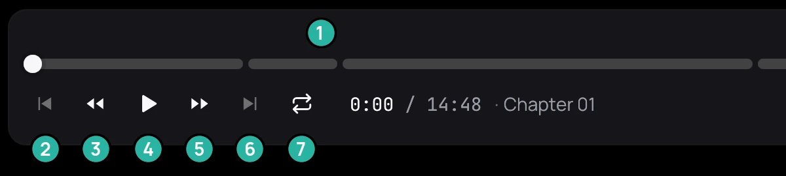
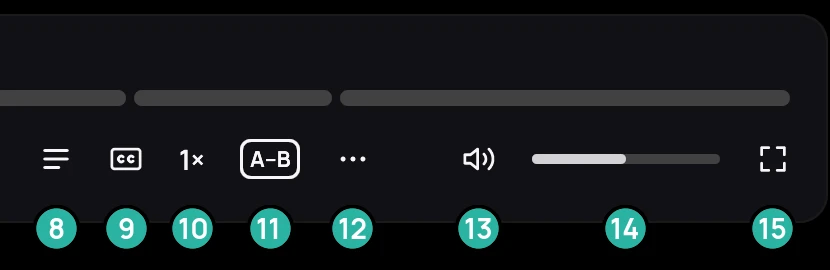
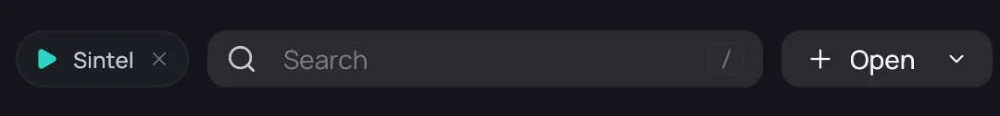

## What it is for

Control playback, and leave the player with or without stopping the film.

1. The timeline: click or drag to jump; its marks are chapters.
2. Previous.
3. Back 10 seconds.
4. Play or pause.
5. Forward 10 seconds.
6. Next (dimmed with nothing to step to).
7. Repeat.
8. Chapters.
9. Audio and subtitle tracks.
10. Speed.
11. More: the right-click menu.
12. Mute.
13. Volume.
14. Fullscreen.

## How to use it

### The playback bar

1. Move the mouse to bring up the bar.
2. Rest the pointer on the timeline, or drag it, to see that moment: a picture, the time and its
   chapter's name.

### Leaving the player

1. Click the arrow at the top left, or press **Esc**: the film stops, saved, and you return to
   the page you started it from. **Library** beside it goes home.
2. Or right-click and choose **Settings**: the film keeps playing, and the logo there leads to the
   library.
3. Click the pill beside **Open** to return to the player, or its cross to stop the film.

## Good to know

- A right-click on either 10-second button also steps to the previous or next item — see
  [Next episode and queue](next-episode.md).
- Closing Kaveo while a film plays saves its position, and so does every pause and every 10
  seconds of playback (for a private title, every pause only). When you open the film again,
  **Resume from 12:34** starts 30 seconds before the point where you stopped.
