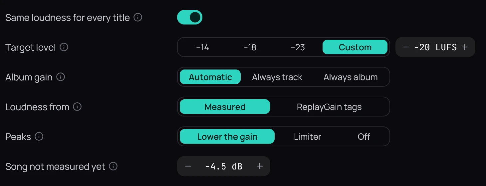

## What it is for

Every title plays equally loud, so you stop reaching for the volume between a quiet film and a loud
song.

## How to use it

1. In **Settings › Audio**, turn on **Same loudness for every title**.
2. Pick a **Target level**: **−18** is the usual, **−14** louder, **−23** quieter; **Custom** sets any level from −24 to −10.
3. **Album gain** on **Automatic** keeps an album's quiet and loud songs apart when it plays in order.
4. **Loudness from**: **Measured**, or **ReplayGain tags** if another program levelled your music.
5. **Peaks**: **Lower the gain** never touches a title's dynamics; **Limiter** reaches the target exactly; **Off** lets a loud peak clip.

## Good to know

- To make everything louder or quieter, use the volume, not the target.
- With **Off**, lowering Kaveo's volume leaves room for the peaks; a device's own volume does not.
- **Song not measured yet** sets how quietly a song plays until it is measured.
