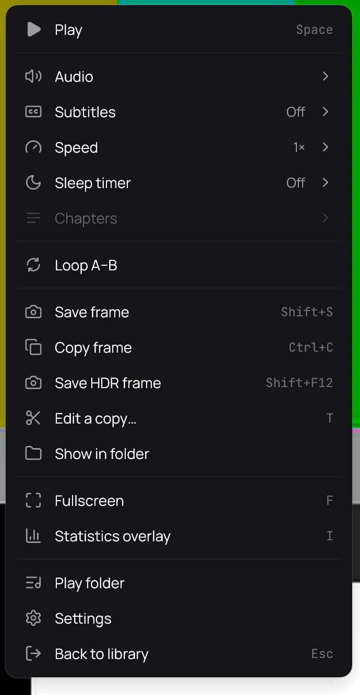

## What it is for

Save the picture of an HDR video with its full brightness and colour, as a 16-bit PNG that
HDR-aware apps and browsers show in HDR. Like [Saving a frame](save-a-frame.md), it is the video's
own picture, at its own size, without the controls or the subtitles.

## How to use it

1. Pause on the moment you want in an HDR video.
2. Right-click the picture and choose **Save HDR frame**, or press **Shift+F12**.
3. A message names the new picture, which ends in *HDR*; click the folder beside it to open where it
   went.

## Good to know

- The picture is saved the same way whether or not your screen is in HDR.
- An app that does not understand HDR pictures shows it washed out; that is the app, not the file.
- There is no **Save HDR frame** for a private title, a video that is not HDR, or while the neural
  upscaler is on.
