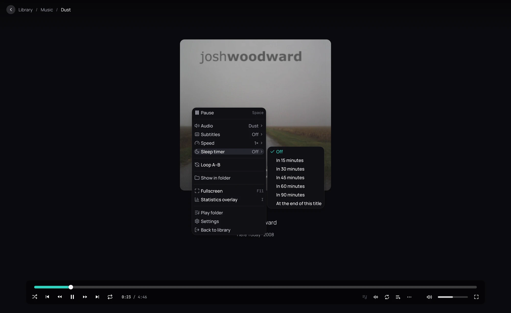

## What it is for

Fall asleep to an audiobook, a podcast or a film without it playing all night.

## How to use it

1. While something plays, right-click the player and open **Sleep timer**.
2. Choose how long: from 15 to 90 minutes, or **At the end of this title**.
3. When the time is up, playback pauses; at the end of the title, nothing else starts.
4. The menu shows the minutes left; choose **Off** to cancel.

## Good to know

- The timer ends when you close the player, and is not kept after a restart.
- An audiobook (M4B) or any track over 20 minutes picks up exactly where it paused next time.
