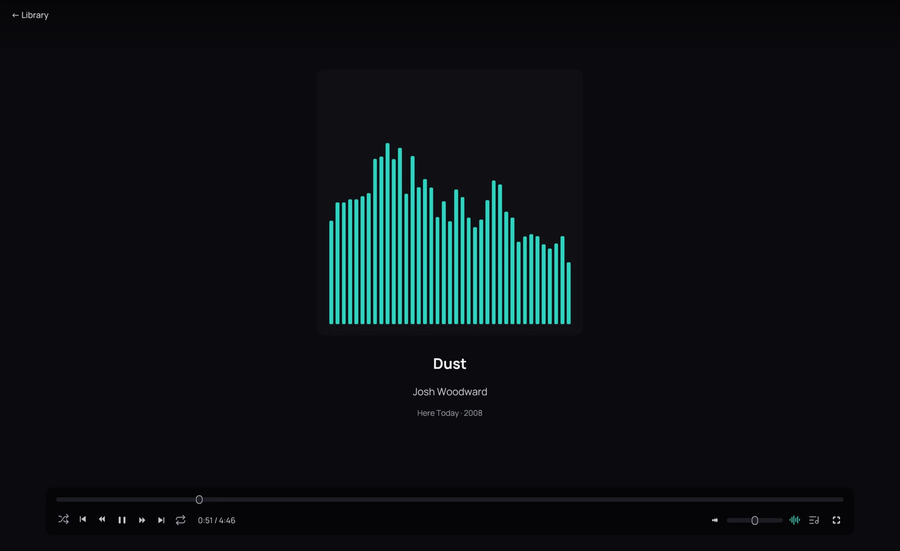

## What it is for

Watch the sound of a track while it plays: its spectrum, or its waveform.

## How to use it

1. Play a track.
2. Click the visualizer button on the playback bar, beside the volume: the spectrum rises over the
   bottom of the cover.
3. Click it again for the oscilloscope, in the cover's place, and once more for the cover alone.
4. Kaveo remembers your choice. **Visualizer** in **Settings › Audio** sets it too.

## Good to know

- It shows what you hear, when you hear it, after the volume and the [equalizer](equalizer.md):
  lower the volume and the bars drop with it.
- A track sent undecoded to a receiver by **Bitstream passthrough** has nothing for Kaveo to draw,
  and the player says so.
- On a narrow window the lyrics take the cover's place, and the visualizer gives way to them.
