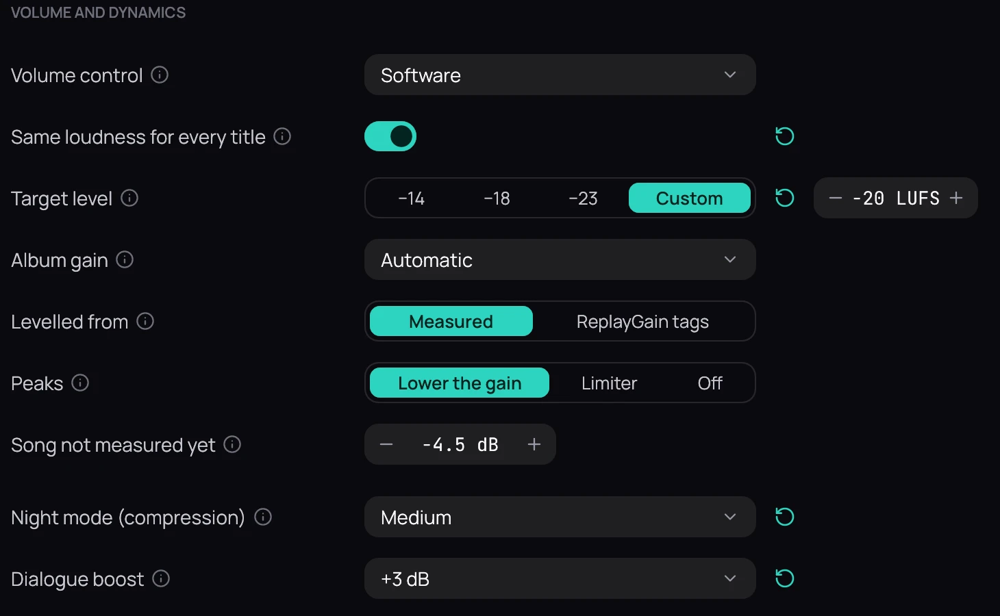

## What it is for

A song, an episode and a film can sound equally loud, a film can be watched quietly, and voices can
stand out.

## How to use it

1. In **Settings › Audio**, turn on **Same loudness for every title**; your local files are measured in the background. The rest is in [Same loudness for every title](same-loudness.md).
2. Set **Night mode (compression)** to **Light**, **Medium** or **Strong** to bring dialogue and explosions closer.
3. Set **Dialogue boost** to **+3 dB** or **+6 dB** to raise the voices.
4. While watching, right-click the picture and open **Audio** › **Sound** to change them.

## Good to know

- None acts on Dolby or DTS sent undecoded with **Bitstream passthrough**.
- **Dialogue boost** needs 5.1 or 7.1 sound: stereo has no separate voice channel.
- The slider goes to 200 %; its middle is the only bit-perfect level. Keys and the wheel stop
  there: press again to go higher. Past the middle that part turns orange, then red. Titles open at
  your last volume.
- With **Volume control** on **Output device**, the slider turns the device's own volume,
  bit-perfect below 100 %. It needs a chosen **Audio output device** with **Exclusive output** on;
  its volume returns afterwards, even after a crash.
- On Linux the desktop's mixer can silence Kaveo, and the server remembers it. A notice then says
  so; **Unmute** brings the sound back.
- Music levelled elsewhere (ReplayGain) plays at that level until Kaveo measures it, or for good
  with **Levelled from** on **ReplayGain tags**.
